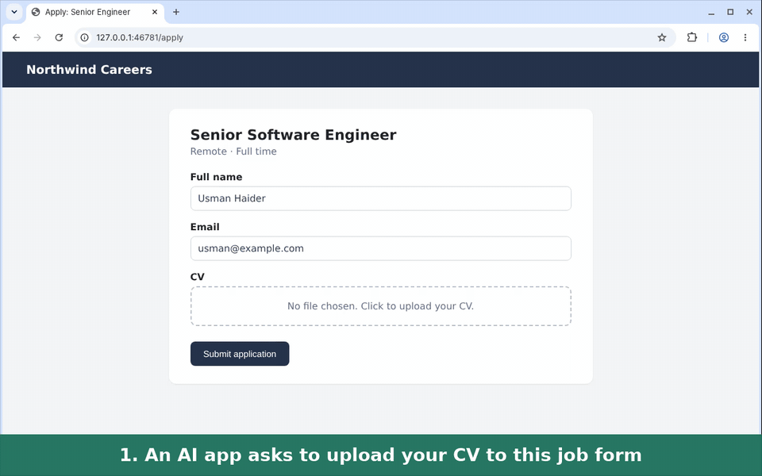
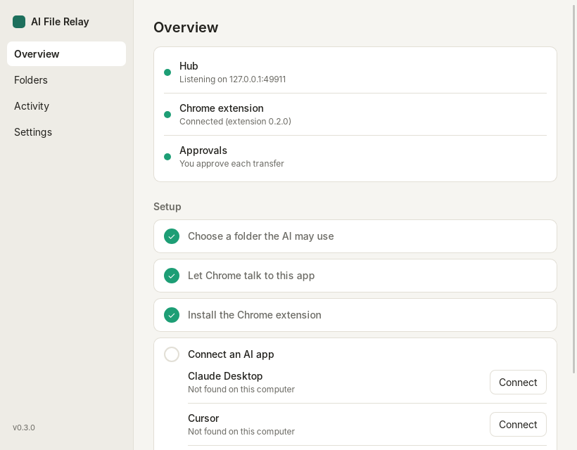
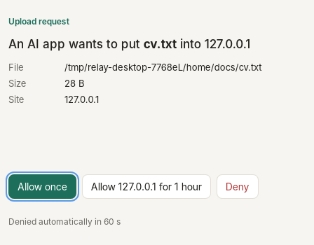

# AI File Relay

**Let any AI app put files into web pages and get downloads back, safely, without spinning up a temporary server.**

> **Status: v0.1, first release.** The desktop app, the Chrome extension and the MCP server work together end to end, tested in CI with real Chrome and real clicks on the approval popup. Installers are on the [Releases page](https://github.com/usmanhaider140/ai-file-relay/releases); they are not code-signed yet, so your system may warn you the first time you open the app.

<p align="center">
  
</p>

<p align="center">
  
  
</p>

## The problem

AI agents are good at using the browser, but moving files is hard. To upload a file to a website, or hand a downloaded file back to the AI, agents often start a throwaway web server or push file bytes through the chat. That is slow, fragile and not very safe.

## The idea

AI File Relay is a small free tool with three parts that work as one:

| Part | What it does | Written in |
| --- | --- | --- |
| **Desktop app (the hub)** | Runs in the menu bar. Keeps the list of allowed folders, asks you to approve each transfer, and keeps a history. | Rust (Tauri 2) |
| **MCP server** | Gives any MCP client (Claude, Cursor, VS Code and others) simple tools like `upload_to_page` and `wait_for_download`. | Rust (`rmcp`) |
| **Chrome extension** | Puts files into upload boxes on web pages and catches finished downloads. | TypeScript |

```
AI app ──MCP──▶ Desktop hub ◀──native messaging──▶ Chrome extension ──▶ web page
                    │                                     ▲
                    └──────── file bytes (localhost) ─────┘
```

## Safe by default

- The hub listens on `127.0.0.1` only.
- The AI can only reach folders you allow. `..` and symlinks cannot escape them, and folders like `~/.ssh` are always blocked.
- You approve every upload.
- File links work once and expire quickly.
- No cloud, no account, no telemetry.

## Roadmap

| Milestone | What you get |
| --- | --- |
| **M0 · Project setup** ✅ | Workspace, CI, licenses, first safety rules |
| **M1 · Hub + MCP** ✅ | MCP tools working in Claude Desktop |
| **M2 · Extension** ✅ | Uploads and downloads working end to end |
| **M3 · Desktop app** ✅ | Tray app, approval popup, one hub for all AI apps, installer builds |
| **M4 · Release v0.1** | Installers, auto-update, crates.io, Chrome Web Store, MCP directories |
| **Next** | Code signing, Firefox, more upload widgets: [ideas welcome](https://github.com/usmanhaider140/ai-file-relay/issues) |

## Project layout

```
crates/
  relay-protocol/   shared message types
  relay-core/       allowed folders, path checks, one-time links, approvals, history, config
  relay-mcp/        the `relay-mcp` command: MCP server, local hub, and the
                    native messaging host that Chrome starts
  relay-nmh/        Chrome native messaging framing
apps/
  desktop/          Tauri 2 desktop app (hub, approval popup, tray)
  extension/        Chrome MV3 extension
tests/e2e/          end-to-end tests with real Chrome and the desktop app
docs/               architecture and protocol notes
```

## Try it

You need Chrome (or Chromium, Edge, Brave) and an MCP-capable AI app such as Claude Desktop, Claude Code or Cursor.

**1. Install the desktop app**

Download the installer for your system from the [latest release](https://github.com/usmanhaider140/ai-file-relay/releases): `.dmg` for macOS, `.msi` or `.exe` for Windows, `.deb` or `.AppImage` for Linux.

The builds are not code-signed yet. On macOS, right-click the app and choose **Open** the first time. On Windows, choose **More info → Run anyway**.

Open **AI File Relay**. It lives in the menu bar / system tray; closing the window keeps it running, and it updates itself when a new version is out.

Or build it yourself: you need Rust 1.90 or newer and Node.js 20 or newer (plus the [Tauri system libraries](https://v2.tauri.app/start/prerequisites/#linux) on Linux), then `cd apps/desktop && npm install && npm run tauri build`. The installer lands in `target/release/bundle/`.

**2. Follow the setup steps in the app**

- **Choose a folder** the AI may use.
- **Set up Chrome**, so the extension can reach the app.
- **Install the extension:** until it is in the Chrome Web Store, download `ai-file-relay-extension-*.zip` from the same release and unzip it. Open `chrome://extensions`, turn on **Developer mode**, click **Load unpacked** and pick the unzipped folder.
- **Connect an AI app:** one click for Claude Desktop and Cursor, or copy the command for Claude Code. Restart the AI app.

Now ask your AI app, for example: *"Use AI File Relay to upload cv.pdf to the job form in my browser."* The app shows a popup; you choose **Allow once**, **Allow this site for 1 hour**, or **Deny**. If nobody answers within 60 seconds, the answer is no.

### Without the desktop app

`relay-mcp` also works on its own (no popup, no tray):

```sh
cargo install ai-file-relay     # the `relay-mcp` command
relay-mcp init
relay-mcp allow ~/Documents/ai-files
relay-mcp install-native-host
```

Add `relay-mcp` to your AI app (for Claude Desktop: Settings → Developer → Edit Config, then `{"mcpServers": {"ai-file-relay": {"command": "/full/path/to/relay-mcp"}}}`; for Claude Code: `claude mcp add ai-file-relay -- relay-mcp`). Without the desktop app there is no popup, so approvals set to `"ask"` are refused: set `approval = "allow_all"` in the settings file (`relay-mcp config` shows where) only for testing on your own machine.

Over HTTP instead of stdio: run `relay-mcp serve`, then connect your MCP client to `http://127.0.0.1:<port>/mcp` with `Authorization: Bearer <token>` (`relay-mcp config --show-token` prints both).

### Tools

| Tool | What it does |
| --- | --- |
| `list_files` | Lists allowed folders and what is inside them |
| `list_tabs` | Lists open Chrome tabs |
| `upload_to_page` | Puts a file into a page's upload box: a normal or hidden file input, or a drag-and-drop area (pass `selector`) |
| `wait_for_download` | Waits for the page's next download and returns its path in the inbox folder |
| `relay_status` | Shows setup, connection and recent transfers |

### Good to know

- **One hub for every AI app.** When the desktop app runs, each AI app's `relay-mcp` forwards to it, so Claude Desktop, Claude Code and Cursor can all use the browser, the same popup and the same history at once. Without the desktop app, the first `relay-mcp` that starts becomes the hub and the others forward to it.
- **Start the desktop app first** (or turn on *Start when I log in* in its settings). If an AI app's `relay-mcp` already holds the port, the desktop app says so and takes over as soon as that AI app quits.
- **Why the extension asks for access to all sites:** it can only put a file into a page it is allowed to script. It does nothing on a page until the AI asks for an upload there.
- **Downloads** are copied into the inbox folder and never overwrite an older file.

### Settings

`relay-mcp config` shows where the settings file is. The main settings:

| Setting | Default | Meaning |
| --- | --- | --- |
| `allowed_folders` | none | Folders the AI may use (`relay-mcp allow` / `disallow`) |
| `approval` | `"ask"` | `"ask"` shows the desktop app's popup (without the app, transfers are refused). `"allow_all"` allows every transfer inside allowed folders: only for testing. `"deny_all"` turns transfers off. The desktop app changes this in its Settings page. |
| `max_file_mb` | `100` | Largest file that can be uploaded |
| `port` | random | Port of the local hub on 127.0.0.1 |

## Build from source

You need Rust 1.90 or newer, and Node.js 20 or newer for the extension.

```sh
# Rust workspace
cargo test --workspace

# Chrome extension
cd apps/extension
npm install
npm run build      # output in apps/extension/dist

# Desktop app (needs the Tauri system libraries on Linux)
cd apps/desktop
npm install
npm run tauri dev        # run it
npm run tauri build      # installers in target/release/bundle/

# End-to-end tests with real Chrome (Chromium or Chrome for Testing)
cargo build -p ai-file-relay
cd tests/e2e && npm install && CHROME_PATH=/path/to/chrome npm test
# ...and with the desktop app (Linux, needs xvfb and xdotool), see tests/e2e/desktop.mjs
```

Plain `cargo build` and `cargo test` skip the desktop app; use `-p ai-file-relay-desktop` for it.

### Releases

1. `node scripts/set-version.mjs 0.2.0` sets the version everywhere; update `CHANGELOG.md`; commit.
2. Push a tag like `v0.2.0`. `.github/workflows/release.yml` builds installers for macOS (Apple silicon and Intel), Windows and Linux, the auto-update files (signed with the `TAURI_SIGNING_PRIVATE_KEY` secret) and the extension zip, into a draft GitHub release.
   To try the build first without making a release, push a branch named `release-test/<anything>`; the installers are kept as downloadable files on that workflow run.
3. Check the draft and publish it. Publishing runs `.github/workflows/publish-crates.yml`, which publishes the Rust crates to crates.io (needs the `CARGO_REGISTRY_TOKEN` secret). Installed apps see the new version within a few hours.

## Contributing

Help is welcome, especially from people who know Rust, Tauri or Chrome extensions. Read [CONTRIBUTING.md](CONTRIBUTING.md) to get started, and look for issues labelled **good first issue**.

Found a security problem? Please don't open a public issue. See [SECURITY.md](SECURITY.md).

## License

Licensed under either of

- Apache License, Version 2.0 ([LICENSE-APACHE](LICENSE-APACHE))
- MIT license ([LICENSE-MIT](LICENSE-MIT))

at your option.

Unless you explicitly state otherwise, any contribution you submit for inclusion in this project, as defined in the Apache-2.0 license, shall be dual licensed as above, without any additional terms or conditions.
